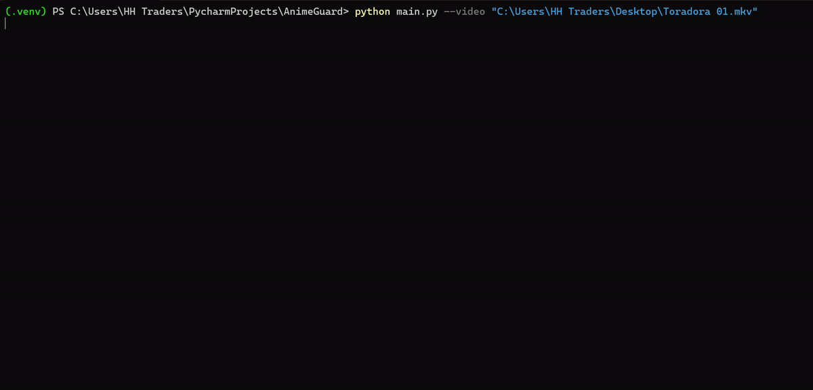

# AnimeGuard

<p align="left">
  <a href="https://www.python.org/">
    
  </a>
  <a href="https://github.com/openai/CLIP">
    
  </a>
  <a href="LICENSE">
    
  </a>
</p>

A local tool that scans an anime episode and flags scenes that look suggestive (or fanservice-y), with timestamps.

It was built for people who want to know where _such scenes_ are before watching, for example with family, so they can skip them.

<br>

<table align="center">
  <tr><th align="left">🔴 🟡 🟢 &nbsp; animeguard-demo.gif</th></tr>
  <tr><td></td></tr>
</table>

<br>

> **AnimeGuard is currently a rough first-pass filter, not an exact detector.** It favors showing you a bit too much over missing a scene, so treat the output as a short list to skim, not as a final answer.

## Table of Content

- [How it works](#how-it-works)
- [Accuracy](#accuracy)
- [Known Limitations & Technical Trade-offs](#known-limitations--technical-trade-offs)
- [Installation](#installation)
  - [1. Install ffmpeg](#1-install-ffmpeg)
  - [2. Get the code](#2-get-the-code)
  - [3. Create and activate a virtual environment](#3-create-and-activate-a-virtual-environment)
  - [4. Install the packages](#4-install-the-packages)
  - [5. First run](#5-first-run)
- [Usage](#usage)
  - [Option A: the input/ folder](#option-a-the-input-folder)
  - [Option B: point at a file with --video](#option-b-point-at-a-file-with---video)
- [Options](#options)
- [Roadmap](#roadmap)
- [License](#license)

## How it works

1. **Extract frames.** ffmpeg extracts one frame at each scene change, plus at least one every 2 seconds so slow shots aren't skipped, scaled down to 480px.
2. **Score with CLIP + a trained classifier.** A local CLIP model turns each frame into an embedding. A small classifier (logistic regression, trained on 10 hand-labeled episodes from 10 different shows) scores each embedding, and a frame is flagged when its score passes the cutoff (`0.7` by default, `0.85` with `--strict`).
3. **Save results.** Flagged frames are copied to `output/flagged/`, their timestamps written to `output/flagged.json`, and the ones close together by a specified gap are grouped into time ranges in `output/flagged_ranges.json`.

## Accuracy

Tested against scenes I labeled by hand. **Precision** is how many flagged ranges were real scenes, and **recall** is how many of the real scenes were found.

| | Precision | Recall |
|---|---|---|
| **10 training shows (each one held out while testing)** | | |
| Original CLIP-only rule | 50% | 82% |
| Classifier, default | 60% | 82% |
| Classifier, `--strict` | 86% | 50% |
| **3 shows it never saw** | | |
| Original CLIP-only rule | 50% | 56% |
| Classifier, default | 53% | 60% |
| Classifier, `--strict` | 80% | 23% |

- On the training shows, the classifier gives fewer false alarms at the same recall. On unseen shows the improvement is small.
- `--strict` gives a short, mostly correct list but misses a lot. Use it when you only want the clearest scenes.
- The labels are one person's opinion, and borderline scenes count as scenes. The 3-show test is small, so treat those numbers as rough.

## Known Limitations & Technical Trade-offs

- **Expect false alarms.** AnimeGuard is tuned for **high recall over high precision**, meaning it throws plenty of false flags just to make sure it doesn't miss anything. Expect some (or more) flagged frames that are actually fine. In my tests, roughly 50-60% of flagged ranges were genuine at the default setting, depending on the episode (`--strict` raises this to about 80%, but misses more scenes). Ranges only a second or two long are more likely to be false-positives.
- **Missed scenes happen.** Missed scenes are possible, even with the best recall optimizations. On shows the classifier had never seen, the default setting found about 60% of the scenes I had labeled, and `--strict` far fewer, so don't treat the output as a complete list. Some stubborn, edge cases will slip through.
- **Weaker on wide shots.** Visual features get harder to pick up in distant background shots by the CLIP model.
- **No sense of motion or context.** CLIP's core nature is that it evaluates single static frames in isolation. It doesn't know what happened before or after.
- **Visuals only.** No audio, dialogue, or subtitle analysis.
- **Startup delay.** PyTorch takes a few seconds to load into memory on startup, and processing a full episode takes a few minutes on CPU.

## Installation

You need Python 3.12+ and ffmpeg beforehand.

### 1. Install ffmpeg

- **Windows:** `winget install "FFmpeg (Essentials Build)"`, then close and reopen your terminal so it's on your PATH.
- **macOS:** `brew install ffmpeg`
- **Linux:** `sudo apt install ffmpeg`

Check with `ffmpeg -version`.

### 2. Get the code

With git:

```
git clone https://github.com/logic-rules/AnimeGuard.git
cd AnimeGuard
```

Without git: download "Source code (zip)" from the [latest release](https://github.com/logic-rules/AnimeGuard/releases/latest), extract it, and open a terminal inside the extracted folder.

### 3. Create and activate a virtual environment

```
python -m venv .venv
```

Then activate it:

- **Windows:** `.venv\Scripts\activate`
- **macOS/Linux:** `source .venv/bin/activate`

Your prompt should now start with `(.venv)`. If it doesn't, the packages in the next step won't install in the right place.

> **Windows PowerShell:** if activating fails with "running scripts is disabled on this system", run `Set-ExecutionPolicy -Scope Process -ExecutionPolicy Bypass` in the same window and paste again. It only applies to that window.

### 4. Install the packages

```
pip install -r requirements.txt
mkdir input
```

This downloads PyTorch and a few other dependencies (a few hundred MB), so it can take a while on a slow connection.

### 5. First run

The first run downloads the CLIP model from Hugging Face, so you need internet once. After that, everything runs offline.

## Usage

### Option A: the `input/` folder

1. Put **one** episode file in the `input/` folder (`.mp4`, `.mkv`, `.avi`, `.mov` or `.webm`).
   **Copy it, don't move it.** On Windows, hold **Ctrl** while dragging.
   AnimeGuard never deletes anything in `input/`, but a simple drag can *move* your only copy there, so copying keeps the original safe.
2. Run:
   ```
   python main.py
   ```

If `input/` is empty or holds more than one file, the tool stops with a one-line message.  

### Option B: point at a file with `--video`
 
```
python main.py --video "C:\Videos\Episode 01.mkv"
```
 
The file is read directly from its path. It is never copied, moved or deleted. On Windows, put the path in double quotes if it contains spaces.

**Results** appear in the terminal as a table of time ranges, a one-line summary, and in:
   - `output/flagged/`: copies of the flagged frames
   - `output/flagged.json`: each flagged frame with its timestamp (`MM:SS`)
   - `output/flagged_ranges.json`: flagged frames merge into time ranges (`MM:SS-MM:SS`)

`frames/` and `output/flagged/` are wiped at the start of every run, so move anything you want to keep. `input/` is never touched.

**Note:**
The progress bar needs a real terminal (PowerShell, Terminal, etc.). In PyCharm's Run window the bar may not be present, but the results are the same.

## Options

| Flag           | Default | What it does                                                                                                                                                                                                                                    |
|----------------|---------|-------------------------------------------------------------------------------------------------------------------------------------------------------------------------------------------------------------------------------------------------|
| `--strict`     | off     | Uses a stricter cutoff (`0.85` instead of `0.7`). Far fewer false alarms (about 80% of flagged ranges were genuine in my tests), but it finds fewer scenes, so expect more misses. Good when you only want a short list of the clearest scenes. |
| `--gap`        | `15`    | Flagged frames closer together than this many seconds are merged into one range.                                                                                                                                                                |
| `--video PATH` | none    | Scan a file by its path, skipping `input/`.                                                                                                                                                                                                     |
| `--threads`    | auto    | CPU threads used by CLIP. Leave it unset and PyTorch picks based on your CPU.                                                                                                                                                                   |
| `--extra`      | off     | Print per-frame details.                                                                                                                                                                                                                        |

Run `python main.py --help` for the same list.

## Roadmap

A heavier vision-language second pass to cut false positives further is being considered. A middle cutoff between the default and `--strict` is also planned.

## License

MIT. See [LICENSE](LICENSE).

---

*Planned and built while learning. AI helped by explaining concepts, suggesting approaches and giving code snippets. Claude helped draft this README.*
