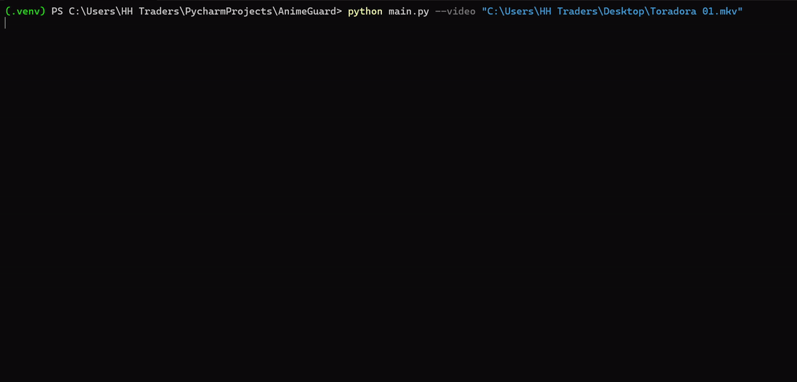

# AnimeGuard

<p align="left">
  
  
  
</p>

A local tool that scans an anime episode and flags scenes that look suggestive (or like fanservice), with timestamps.

It was built for people who want to know where the questionable scenes are before watching, for example with family, so they can skip them.

<br>

<table align="center">
  <tr><th align="left">🔴 🟡 🟢 &nbsp; animeguard-demo.gif</th></tr>
  <tr><td></td></tr>
</table>

<br>

> **AnimeGuard is a rough first-pass scout, not an exact detector.** It favors showing you too much over missing a scene, so treat the output as a shortlist to skim, not as a final answer.

## How it works

1. **Extract frames.** ffmpeg extracts one frame at a scene change (not at fixed intervals), scaled down to 480px.
2. **Screen with CLIP (Pass 1).** Each frame is compared by a local CLIP model against two sets of text descriptions: suggestive ones and "safe" ones (faces, school uniforms, scenery, and so on). A frame is flagged when it matches a suggestive description clearly better than any safe one. Near-duplicate flagged frames are removed.
3. **Save results.** Flagged frames are copied to `flagged/`, their timestamps written to `flagged.json`, and the ones close together by a specified gap are grouped into time ranges in `flagged_ranges.json`.

## Known Limitations & Technical Trade-offs

- AnimeGuard is tuned for **high recall over high precision**, so it leans toward false alarms. Expect some (or more) flagged frames that are actually fine. On the episodes I checked, roughly 50-70% of flagged ranges were genuine, depending on the episode. Ranges only a second or two long are more likely to be false-positives.
- Recall (how many real scenes get caught) has not been measured. Spot checks showed few misses, but a missed scene is invisible by nature.
- It is weaker on wide shots and on frames focused on male characters.
- It looks at single still frames, so it has no sense of motion/context.
- A timestamp marks where a shot starts, not how long the content lasts.
- Tuning the labels was tested on a handful of episodes. Any safe label you add can also "steal" a genuinely suggestive frame, so the labels are intentionally left as they are.
- **Missed scenes.** At the default `--margin 0.03`, a few borderline frames (very wide shots, low-contrast frames, unusual angles) can slip under the threshold. For more recall, lower `--margin` toward `0.025` or `0.015` and expect many more false flags. Some stubborn frames will still be missed. A second-stage filter (or a Pass 2) can remove/discard false flags but can't recover a genuine frame that Pass 1 never flagged.
- Visual only. Audio, dialogue and subtitles are not analyzed. (yet)
- Startup takes a few seconds while PyTorch loads, and a full episode takes minutes on a CPU.

## Install

You need Python 3.12+ (developed on 3.14) and ffmpeg.

1. **Install ffmpeg.**
   - Windows: `winget install "FFmpeg (Essentials Build)"`, then close and reopen your terminal so it's on your PATH.
   - macOS: `brew install ffmpeg`
   - Linux: `sudo apt install ffmpeg`

   Check it with `ffmpeg -version`.
2. **Get the code and install the packages:**
   ```
   git clone https://github.com/logic-rules/AnimeGuard.git
   cd AnimeGuard
   python -m venv .venv
   ```
   Activate the virtual environment (Windows: `.venv\Scripts\activate`, macOS/Linux: `source .venv/bin/activate`), then:
   ```
   pip install -r requirements.txt
   mkdir input
   ```
   After the `activate` line, your prompt should start with `(.venv)`. If it doesn't, the packages won't install in the right place.
   On macOS/Linux, use `source .venv/bin/activate` instead of `.venv\Scripts\activate`.
   The installation downloads torch, which is a large download.
3. The first run downloads the CLIP model from Hugging Face, so you need internet once. After that, everything runs offline.

## Usage

**Option A: the `input/` folder**

1. Put **one** episode file in the `input/` folder (`.mp4`, `.mkv`, `.avi`, `.mov` or `.webm`).
   **Copy it, don't move it.** On Windows, hold **Ctrl** while dragging.
   AnimeGuard never deletes anything in `input/`, but a plain drag can *move* your only copy there, so copying keeps the original safe.
2. Run:
   ```
   python main.py
   ```

If `input/` is empty or holds more than one file, the tool stops with a one-line message.  

**Option B: point at a file with `--video`**
 
```
python main.py --video "C:\Videos\Episode 01.mkv"
```
 
The file is read where it is. It is never copied, moved or deleted, so the Ctrl+drag caveat above only applies to Option A. On Windows, put the path in double quotes if it contains spaces.

**Results** appear in the terminal as a table of time ranges, and in:
   - `flagged/`: copies of the flagged frames
   - `flagged.json`: one entry per flagged frame, with its timestamp
   - `flagged_ranges.json`: nearby flags grouped into time ranges

`frames/` and `flagged/` are wiped at the start of every run, so move anything you want to keep. `input/` is never touched.

**Note:**
The progress bar needs a real terminal (PowerShell, Terminal, etc.). In PyCharm's Run window the bar isn't present, but the results are the same.

## Options
 
| Flag | Default | What it does |
|---|---|---|
| `--margin` | `0.03` | How strongly a frame must lean suggestive to be flagged. Lower it (for example `0.015`) to catch borderline frames, but expect more false alarms. |
| `--gap` | `15` | Flagged frames closer together than this many seconds are merged into one range. |
| `--video PATH` | none | Scan a file where it is, skipping `input/`. |
| `--threads` | `6` | CPU threads used by CLIP. |
| `--extra` | off | Print per-frame details, dedup summary, etc. |
 
Run `python main.py --help` for the same list.

## Roadmap

A second-stage classifier on CLIP embeddings, to cut false positives, is planned for a future release. A heavier vision-language Pass 2 is only considered after that.

## License

MIT. See [LICENSE](LICENSE).

---

*Planned and built while learning. Claude and Gemini helped by explaining concepts, suggesting approaches and giving code snippets. Claude also helped draft this README.*