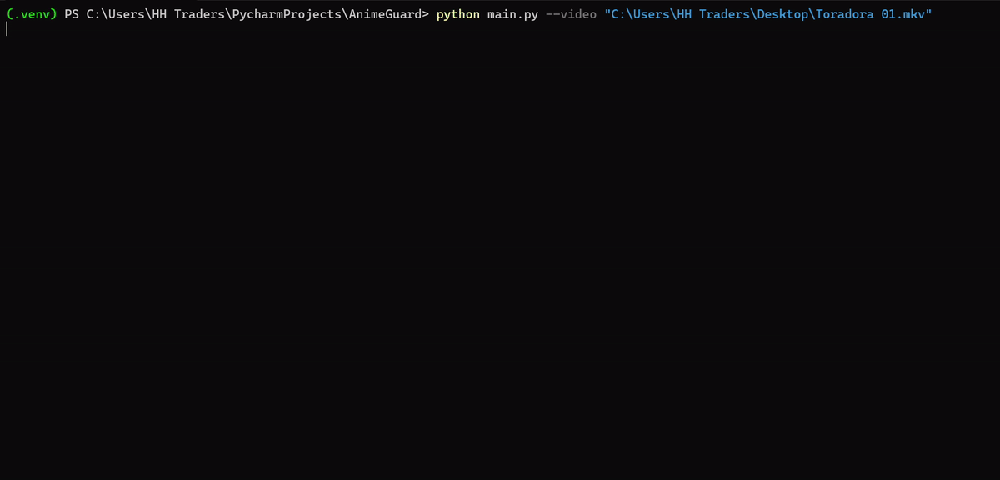

# AnimeGuard

<p align="left">
  <a href="https://www.python.org/">
    
  </a>
  <a href="https://github.com/openai/CLIP">
    
  </a>
  <a href="LICENSE">
    
  </a>
</p>

A local tool that scans an anime episode and flags scenes that look suggestive (or fanservice-y), with timestamps.

It was built for people who want to know where _such scenes_ are before watching, for example with family, so they can skip them.

<br>

<table align="center">
  <tr><th align="left">🔴 🟡 🟢 &nbsp; animeguard-demo.gif</th></tr>
  <tr><td></td></tr>
</table>

<br>

> **AnimeGuard is currently a rough first-pass filter, not an exact detector.** It favors showing you too much over missing a scene, so treat the output as a short list to skim, not as a final answer.

## Table of Content

- [How it works](#how-it-works)
- [Known Limitations & Technical Trade-offs](#known-limitations--technical-trade-offs)
- [Installation](#installation)
  - [1. Install ffmpeg](#1-install-ffmpeg)
  - [2. Get the code](#2-get-the-code)
  - [3. Create and activate a virtual environment](#3-create-and-activate-a-virtual-environment)
  - [4. Install the packages](#4-install-the-packages)
  - [5. First run](#5-first-run)
- [Usage](#usage)
  - [Option A: the input/ folder](#option-a-the-input-folder)
  - [Option B: point at a file with --video](#option-b-point-at-a-file-with---video)
- [Options](#options)
- [Roadmap](#roadmap)
- [License](#license)

## How it works

1. **Extract frames.** ffmpeg extracts one frame at a scene change (not at fixed intervals), scaled down to 480px.
2. **Screen with CLIP (Pass 1).** Each frame is compared by a local CLIP model against two sets of text descriptions: suggestive ones and "safe" ones (faces, school uniforms, scenery, and so on). A frame is flagged when it matches a suggestive description clearly better than any safe one. Near-duplicate flagged frames are removed.
3. **Save results.** Flagged frames are copied to `flagged/`, their timestamps written to `flagged.json`, and the ones close together by a specified gap are grouped into time ranges in `flagged_ranges.json`.

## Known Limitations & Technical Trade-offs

- **Expect false alarms.** AnimeGuard is tuned for **high recall over high precision**, meaning it throws plenty of false flags just to make sure it doesn't miss anything. Expect some (or more) flagged frames that are actually fine. On the episodes I checked, roughly 50-70% of flagged ranges were genuine, depending on the episode (this is aimed to improve in later releases). Ranges only a second or two long are more likely to be false-positives.
- **Missed scenes happen.** Missed scenes are possible, even with the best recall optimizations. Unless you rewatch everything manually, it's hard to measure exact miss rates. Spot checks showed few misses, but some stubborn, edge cases will slip through.
- **Weaker on wide shots.** Visual features get harder to pick up in distant background shots by the Pass 1 CLIP model.
- **No sense of motion or context.** CLIP's core nature is that it evaluates single static frames in isolation. It doesn't know what happened before or after.
- **Sensitive prompt tuning.** The CLIP prompt descriptions were tuned on a small set of episodes. Adding safer prompts to filter false flags can accidentally "steal" real hits, so the labels are intentionally kept as-is for now.
- **Borderline misses.** At the default `--margin 0.03`, low-contrast frames or weird camera angles have a chance of dropping below the threshold. Lowering `--margin` toward `0.015` catches more of these, but expect a flood of false flags.
- **Visuals only.** No audio, dialogue, or subtitle analysis.
- **Startup delay.** PyTorch takes a few seconds to load into memory on startup, and processing a full episode takes a few minutes on CPU.

## Installation

You need Python 3.12+ and ffmpeg beforehand.

### 1. Install ffmpeg

- **Windows:** `winget install "FFmpeg (Essentials Build)"`, then close and reopen your terminal so it's on your PATH.
- **macOS:** `brew install ffmpeg`
- **Linux:** `sudo apt install ffmpeg`

Check with `ffmpeg -version`.

### 2. Get the code

With git:

```
git clone https://github.com/logic-rules/AnimeGuard.git
cd AnimeGuard
```

Without git: download "Source code (zip)" from the [latest release](https://github.com/logic-rules/AnimeGuard/releases/latest), extract it, and open a terminal inside the extracted folder.

### 3. Create and activate a virtual environment

```
python -m venv .venv
```

Then activate it:

- **Windows:** `.venv\Scripts\activate`
- **macOS/Linux:** `source .venv/bin/activate`

Your prompt should now start with `(.venv)`. If it doesn't, the packages in the next step won't install in the right place.

> **Windows PowerShell:** if activating fails with "running scripts is disabled on this system", run `Set-ExecutionPolicy -Scope Process -ExecutionPolicy Bypass` in the same window and paste again. It only applies to that window.

### 4. Install the packages

```
pip install -r requirements.txt
mkdir input
```

This downloads PyTorch and a few other dependencies (a few hundred MB), so it can take a while on a slow connection.

### 5. First run

The first run downloads the CLIP model from Hugging Face, so you need internet once. After that, everything runs offline.

## Usage

### Option A: the `input/` folder

1. Put **one** episode file in the `input/` folder (`.mp4`, `.mkv`, `.avi`, `.mov` or `.webm`).
   **Copy it, don't move it.** On Windows, hold **Ctrl** while dragging.
   AnimeGuard never deletes anything in `input/`, but a simple drag can *move* your only copy there, so copying keeps the original safe.
2. Run:
   ```
   python main.py
   ```

If `input/` is empty or holds more than one file, the tool stops with a one-line message.  

### Option B: point at a file with `--video`
 
```
python main.py --video "C:\Videos\Episode 01.mkv"
```
 
The file is read directly from its path. It is never copied, moved or deleted. On Windows, put the path in double quotes if it contains spaces.

**Results** appear in the terminal as a table of time ranges, a one-line summary, and in:
   - `flagged/`: copies of the flagged frames
   - `flagged.json`: each flagged frame, with its timestamp
   - `flagged_ranges.json`: time ranges of nearby flags

`frames/` and `flagged/` are wiped at the start of every run, so move anything you want to keep. `input/` is never touched.

**Note:**
The progress bar needs a real terminal (PowerShell, Terminal, etc.). In PyCharm's Run window the bar may not be present, but the results are the same.

## Options
 
| Flag | Default | What it does                                                                                                                                      |
|---|---|---------------------------------------------------------------------------------------------------------------------------------------------------|
| `--margin` | `0.03` | How strongly a frame must lean suggestive to be flagged. Lower it (for example `0.015`) to catch borderline frames, but expect more false alarms. |
| `--gap` | `15` | Flagged frames closer together than this many seconds are merged into one range.                                                                  |
| `--video PATH` | none | Scan a file by its path, skipping `input/`.                                                                                                       |
| `--threads` | auto | CPU threads used by CLIP. Leave it unset and PyTorch picks based on your CPU.                                                                     |
| `--extra` | off | Print per-frame details, dedup summary, etc.                                                                                                      |
 
Run `python main.py --help` for the same list.

## Roadmap

A second-stage classifier on CLIP embeddings, to cut false positives from first scan, is planned for a future release. A heavier vision-language Pass 2 is considered after that.

## License

MIT. See [LICENSE](LICENSE).

---

*Planned and built while learning. AI helped by explaining concepts, suggesting approaches and giving code snippets. Claude also helped draft this README.*